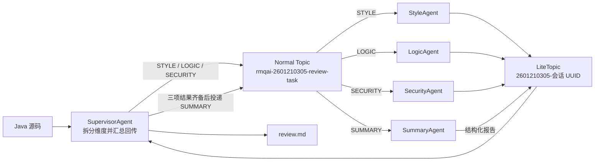

# 系统架构与验收

## Agent 拓扑图

[下载拓扑图 PNG 原图](五类Agent拓扑图.png)

## Topic、消费组与命名

| 资源 | 名称 | 用途 |
| --- | --- | --- |
| 普通任务 Topic | `rmqai-2601210305-review-task` | 用 STYLE、LOGIC、SECURITY、SUMMARY 四个 Tag 路由任务 |
| 任务消费组 | `GID_2601210305_style`、`GID_2601210305_logic`、`GID_2601210305_security`、`GID_2601210305_summary` | 各角色仅订阅自己的 Tag |
| Lite 父 Topic | `rmqai-2601210305-review-response` | 保存审查及最终报告的轻量响应 |
| Lite 回传消费组 | `GID_2601210305_supervisor` | 绑定 Lite 父 Topic，使用本地 Broker 的 Exclusive 模式 |
| LiteTopic、Session | `2601210305-<UUID>` | 每次审查对应独立会话 |
| 消息 Key | `<Session>-task-<角色>`、`<Session>-result-<角色>` | 按学号、会话和阶段关联记录 |

## 消息流转

1. Supervisor 先订阅自己的 LiteTopic，再异步投递三项审查任务。三类 Worker 通过各自的 PushConsumer 独立处理。
2. Worker 将结果写入同一个会话 LiteTopic。Supervisor 核对会话、请求 ID 和业务 Key，使用每个角色的完成状态收集结果，重复响应不会增加计数。
3. 三项结果全部到齐后，Supervisor 向 Normal Topic 投递 SUMMARY。SummaryAgent 检查三种评审结果完整性，按固定的角色顺序生成 Markdown。最终报告仍由原 LiteTopic 回传。
4. 验收脚本将应用收发日志按消息 ID 和 Key 逐条匹配，再用 Broker 查询确认消息可查及 LiteTopic 消费组存在。轨迹导出器把已观测的 gRPC 发送回执与消费事件编码为 RocketMQ 原生轨迹，写入 `RMQ_SYS_TRACE_TOPIC`。应用日志、Broker 查询日志和原生轨迹日志均按同一会话归档。

Java 项目使用 rocketmq-a2a SDK 的连接构建方法和 `RocketMQRequest`、`RocketMQResponse` 消息封装。任务 Tag 和业务 Key 由调用层设置，以保留角色路由与按 Key 验收的能力。审查使用静态语法规则，过程无需云模型或模型 API 密钥。
